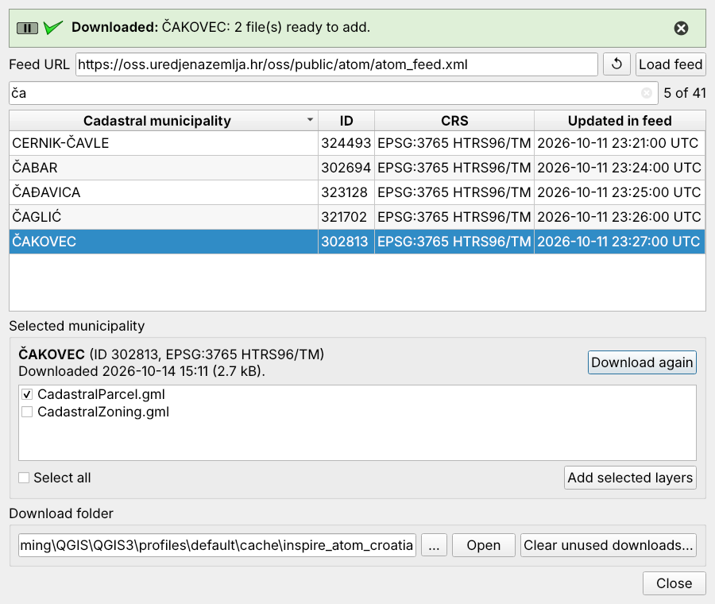
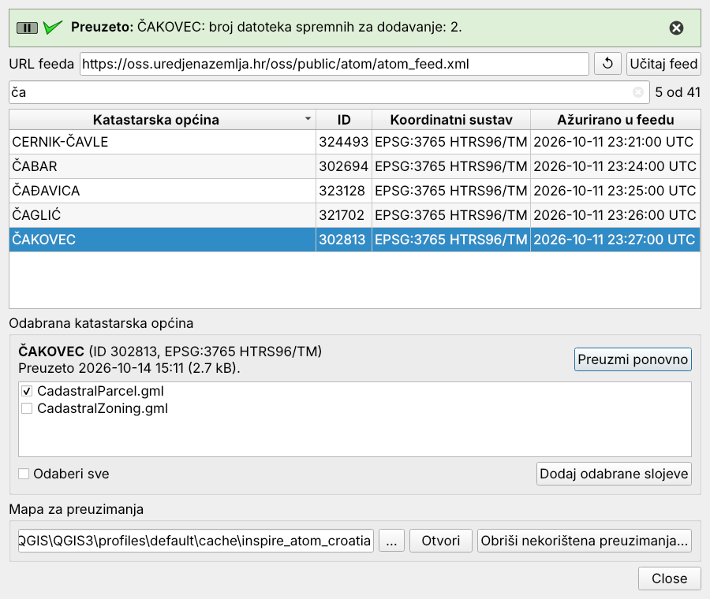

<p align="center">
  
</p>

<h1 align="center">INSPIRE ATOM Croatia – Cadastral Parcels</h1>

<p align="center">
  A QGIS plugin that downloads cadastral data for any Croatian cadastral municipality<br>
  from the national INSPIRE ATOM feed and adds it to your project in a few clicks.
</p>

<p align="center">
  
  
  
</p>

<p align="center">
  
</p>

The Croatian State Geodetic Administration (Državna geodetska uprava, DGU) publishes the cadastral
plan for every cadastral municipality (katastarska općina, k.o.) as a zipped GML dataset, listed in an
[INSPIRE ATOM download feed](https://oss.uredjenazemlja.hr/oss/public/atom/atom_feed.xml). Finding the
right entry in a feed of several thousand municipalities, downloading the archive, unpacking it and
loading the files by hand gets old quickly. This plugin does all of it from one dialog.

## Features

- **Search** by municipality name or ID. Diacritics are optional: `cakovec` finds ČAKOVEC, while
  typing `ča` matches only names that really contain *č*.
- **Croatian alphabetical sorting** – Č, Ć, Dž, Đ, Lj, Nj, Š and Ž sort where they belong instead of
  after Z. The ID column sorts numerically.
- **Background downloads** with a progress bar. They use QGIS's own network settings, so proxies
  configured in QGIS work without extra setup.
- **Download once, reuse.** Each municipality is unpacked into its own folder and offered again
  next time. The zip archive is deleted after extraction, and the dialog tells you when the feed entry
  was updated after your download.
- **Tidy projects** – layers are added to a group named after the municipality, e.g.
  `ČAKOVEC (302813)`. GML files that contain several feature types are loaded as separate layers.
- **Clear unused downloads** removes downloaded municipalities that the current project does not
  use.
- English and Croatian interface, following the QGIS language setting.

## Installation

**From the QGIS plugin repository** (once published): *Plugins → Manage and Install Plugins…*, search
for **INSPIRE ATOM Croatia** and click *Install*.

**From a zip file:** download the zip from the
[Releases](https://github.com/admilara/inspire_atom_croatia/releases) page, then use
*Plugins → Manage and Install Plugins… → Install from ZIP*.

**From source:** copy the `inspire_atom_croatia` folder into your QGIS profile's `python/plugins`
folder (*Settings → User Profiles → Open Active Profile Folder*) and enable the plugin in the plugin
manager.

## Usage

1. Open the dialog from *Web → INSPIRE ATOM Croatia* or the toolbar button.
2. Click **Load feed**. The list is saved, so the next time the dialog opens it is filled straight away;
   click *Load feed* again whenever you want the latest version.
3. Type part of a name or ID in the search box and select the municipality.
4. Click **Download** (or double-click the row). When it finishes, the GML files in the archive are
   listed.
5. Tick the files you need and click **Add selected layers**.

### Where the data goes

Downloads are kept in `cache/inspire_atom_croatia` inside your QGIS profile folder, one folder per
municipality (`ko-<ID>`). You can choose another folder in the dialog, for example a shared project
drive.

Layers in a saved project point at these files, so keep them for as long as your projects use them.
*Clear unused downloads* only looks at the project that is currently open and asks before deleting
anything.

## Data source and terms of use

All data comes from the State Geodetic Administration of the Republic of Croatia
([dgu.gov.hr](https://dgu.gov.hr)). This plugin only automates the download. Check DGU's terms of use
before using or redistributing the data. The plugin is not affiliated with or endorsed by DGU.

## Development

The parts that do not depend on QGIS (feed parsing, sorting, search and download folder handling)
have unit tests:

```bash
python -m pytest tests
```

**Translations** – after changing user-visible text, update and compile the Croatian translation
(needs the PyQt5 and Qt Linguist tools):

```bash
cd inspire_atom_croatia
pylupdate5 -noobsolete plugin.py dialog.py dialog.ui -ts i18n/inspire_atom_croatia_hr.ts
# translate the new entries in Qt Linguist, then:
lrelease i18n/inspire_atom_croatia_hr.ts
```

**Packaging** – build the zip for plugins.qgis.org:

```bash
python scripts/package.py      # -> dist/inspire_atom_croatia-<version>.zip
```

Bug reports and suggestions are welcome in the
[issue tracker](https://github.com/admilara/inspire_atom_croatia/issues).

## Ukratko na hrvatskom

Dodatak za QGIS koji iz INSPIRE ATOM servisa Državne geodetske uprave preuzima katastarski plan
odabrane katastarske općine i dodaje GML slojeve u projekt. Omogućuje pretragu po nazivu ili ID-u
(dijakritici nisu obavezni), ispravno sortiranje po hrvatskoj abecedi, preuzimanje u pozadini uz
QGIS-ove mrežne postavke te ponovnu upotrebu već preuzetih podataka. Sučelje je dostupno na
hrvatskom i engleskom jeziku, prema jeziku postavljenom u QGIS-u.

<details><summary>Sučelje na hrvatskom</summary>



</details>

## License

[GNU General Public License v3.0 or later](LICENSE) © 2024–2026 Lara Buljan
